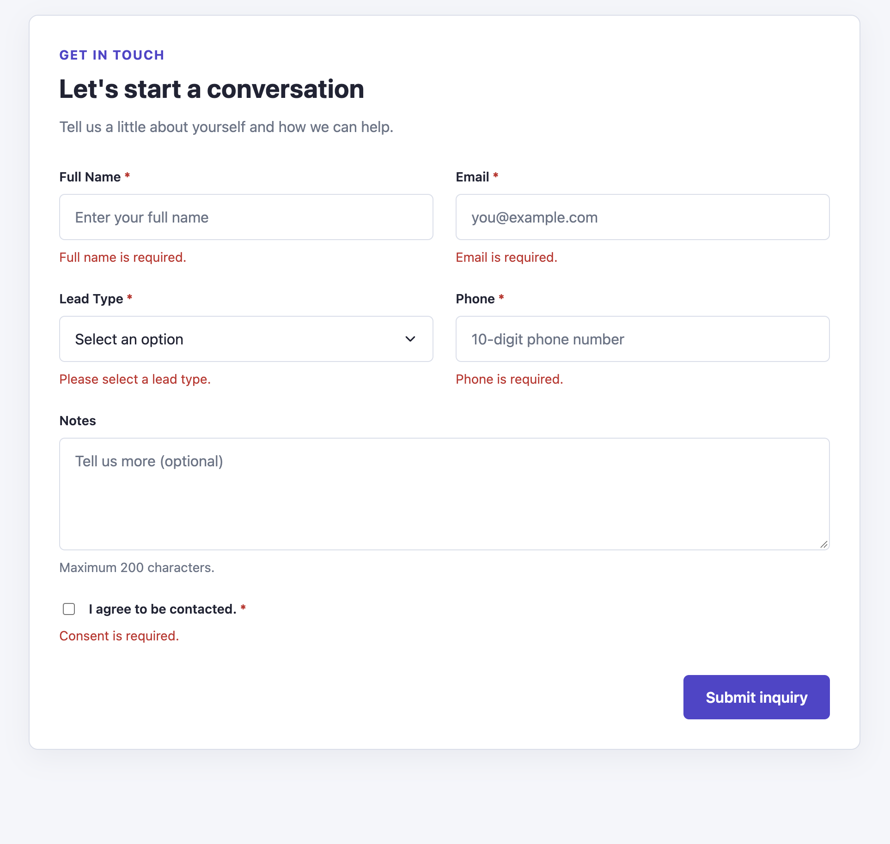
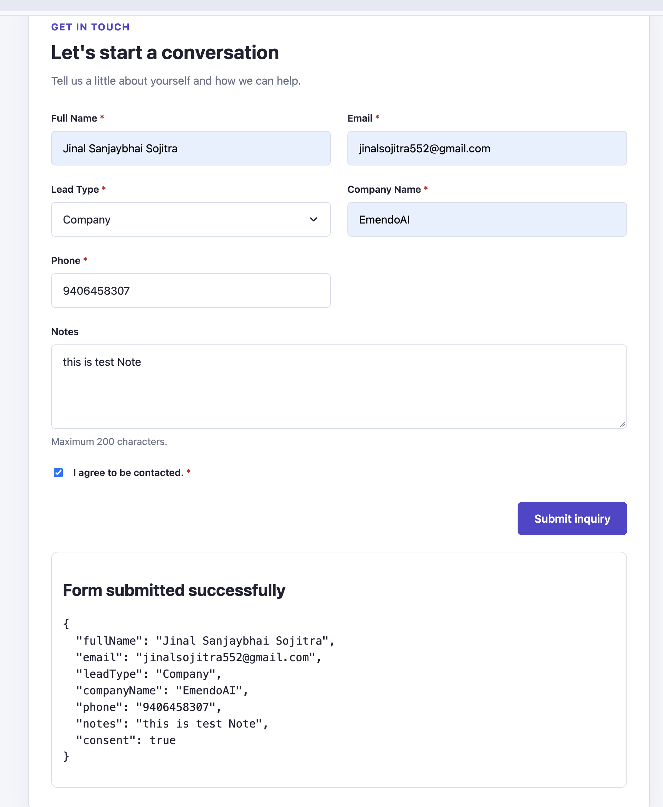

# Dynamic Form and Design System

A responsive, configuration-driven lead inquiry form built with **React, TypeScript, and CSS**. The project demonstrates reusable UI components, centralized design tokens, field-level validation, and responsive layouts without relying on a component library.

## Features

- **Reusable design system:** Shared design tokens for colors, spacing, typography, breakpoints, borders, and other UI styles.
- **Atomic component architecture:** Reusable Input, Select, Checkbox, Button, and Textarea components, composed into a reusable Field molecule.
- **Configuration-driven rendering:** Form fields are generated from a centralized configuration instead of being individually hardcoded in the form.
- **Field validation:** Validates required fields, email format, 10-digit phone numbers, and the maximum length of Notes.
- **Conditional fields:** Company Name is displayed and required only when Lead Type is set to Company.
- **Accessible feedback:** Field labels, validation messages, and ARIA attributes provide clear feedback to users.
- **Responsive layout:** Two-column form layout on desktop and a single-column layout on tablet and mobile.
- **Submission handling:** Prevents submission when validation errors exist and displays the submitted values when the form is valid.

## Tech Stack

- React
- TypeScript
- Vite
- CSS and CSS Modules
- Native HTML form controls

## Getting Started

### Prerequisites

- Node.js
- npm

### Installation

Clone the repository:

```bash
git clone https://github.com/jinal-sojitra/dynamic-form-design-system.git
cd dynamic-form-design-system
```

Install dependencies:

```bash
npm install
```

Start the development server:

```bash
npm run dev
```

Open the local URL printed in your terminal to view the application.

### Production Build

Run the TypeScript and production build checks provided by the project:

```bash
npm run build
```

## Output




## Project Structure

```text
src/
├── app/
│   └── App.tsx
├── design-system/
│   ├── atoms/
│   │   ├── Button.tsx
│   │   ├── Checkbox.tsx
│   │   ├── Input.tsx
│   │   ├── Select.tsx
│   │   └── Textarea.tsx
│   ├── molecules/
│   │   └── Field.tsx
│   └── tokens.css
├── features/
│   └── lead/
│       ├── LeadForm.tsx
│       ├── LeadForm.module.css
│       ├── leadForm.config.ts
│       └── leadValidation.ts
├── index.css
└── main.tsx
```

_Note: The structure above reflects the intended organization. Adjust the file tree to match the final repository if any files are located elsewhere._

## Architecture

### 1. Design Tokens

**Location:** `src/design-system/tokens.css`

Centralizes design decisions such as colors, spacing, typography, breakpoints, and border radii. Shared tokens help maintain visual consistency and make future design changes easier.

### 2. Reusable UI Components

**Location:** `src/design-system/atoms/`

Contains the basic form controls:

- `Input.tsx` — text and email inputs.
- `Select.tsx` — dropdown selection.
- `Checkbox.tsx` — consent checkbox.
- `Button.tsx` — reusable action button.
- `Textarea.tsx` — multiline text input.

These components receive their values and event handlers through props, allowing them to be reused independently of the lead form.

### 3. Field Molecule

**Location:** `src/design-system/molecules/Field.tsx`

Combines a label, control, optional hint, required indicator, and validation error into a reusable field structure. It also connects descriptive text and validation state to the associated control through ARIA attributes.

### 4. Form Configuration

**Location:** `src/features/lead/leadForm.config.ts`

Defines the form fields, their types, labels, required rules, validation constraints, options, and conditional visibility.

The configuration separates field definitions from rendering logic, making it easier to add or modify fields without restructuring the entire form.

### 5. Validation

**Location:** `src/features/lead/leadValidation.ts`

Contains the form validation logic separately from the UI. It checks required values, email format, phone number format, and maximum character length.

Conditional fields are validated only when their visibility conditions are satisfied. Validation errors are displayed alongside their corresponding fields, and invalid submissions are blocked.

### 6. Form Composition and Behavior

**Location:** `src/features/lead/LeadForm.tsx`

Renders the form from the configuration, manages field values and validation errors, handles conditional field visibility, and processes valid submissions.

### 7. Responsive Styling

**Locations:** `src/features/lead/LeadForm.module.css` and `src/index.css`

- **Desktop (above 1024px):** Two-column form layout, with designated fields spanning both columns.
- **Tablet (768px–1024px):** Single-column form layout.
- **Mobile (below 768px):** Single-column layout, full-width controls, and an accessible submit action.

Global styles define shared control styles, while the form CSS module manages the form-specific grid and responsive behavior.

## Form Fields and Validation

| Field        | Validation / Behavior                   |
| ------------ | --------------------------------------- |
| Full Name    | Required                                |
| Email        | Required; valid email format            |
| Lead Type    | Required; Individual or Company         |
| Company Name | Required only when Lead Type is Company |
| Phone        | Required; exactly 10 digits             |
| Notes        | Optional; maximum 200 characters        |
| Consent      | Required; must be checked               |

Validation runs on blur and on submission. On submission, all applicable errors are displayed, and the submitted values are shown only when the form is valid.

## Design Principles

- Separation of concerns between UI, configuration, and validation.
- Reusable components with explicit props and TypeScript types.
- Centralized design tokens instead of scattered design values.
- Configuration-driven form rendering to minimize duplication.
- Responsive and accessible form interactions.
- Maintainable architecture that supports adding new fields and validation rules.

## Future Improvements

- Add automated unit tests for validation rules.
- Add component and form interaction tests.
- Support additional field types and configurable validation rules.
- Connect the form to a backend submission API.

## Author

**Jinal Sojitra**

Built as a dynamic form and design system assignment.
